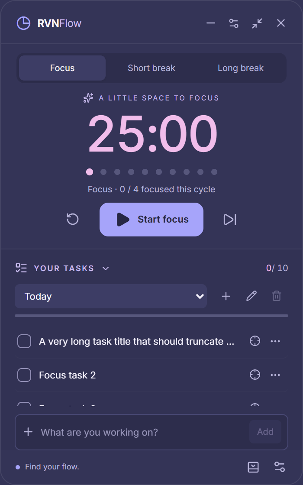

# RVNFlow

**A little space to focus.** A small, offline Pomodoro widget for Windows 10/11.
Built with Rust, Tauri 2, and Svelte 5. No account, cloud service, or telemetry.
Version 0.2 repairs native freezes, automatically prepares the next session, and adds
independent auto-start preferences, taskbar minimization and a clearer task workspace.
See [repair findings and verification](docs/V0.2_BUGS.md).




Screenshots show the real frontend rendered in Edge with test data and mocked IPC;
they are not evidence of native Windows behavior.

## Features

- A 210 × 105 compact widget and 350 × 560 expanded workspace.
- Rust-owned focus, short-break and long-break sessions; pause, resume, reset and skip.
- Sleep-aware timing, restart recovery, and ten quiet progress dots.
- Multiple task lists, completion tracking, editing, ordering, and a current focus task.
- Three original alarms, custom WAV/MP3 import, two optional ticks, and separate volumes.
- Always-on-top, tray controls, single instance, monitor-aware positioning, optional startup and notifications.
- Local JSON with atomic replacement, a previous-state backup, validation, and corruption recovery.
- Keyboard controls, accessible button names, and system/application reduced-motion preferences.

## Downloads

- [Latest stable release](https://github.com/rvn14/rvnflow/releases/latest)
- [Development builds, newest first](https://github.com/rvn14/rvnflow/releases?q=dev-&expanded=true)
- [Windows CI installer artifacts](https://github.com/rvn14/rvnflow/actions/workflows/ci.yml) (GitHub sign-in required)

The release links become available after a maintainer publishes a build. No release is
automatically published by the initial implementation push. Development prereleases
are public downloads once published and do not require GitHub sign-in for a public repository.

Download the x64 setup `.exe`, compare its SHA-256 with `SHA256SUMS.txt`, and run it.
Installation is per-user and does not normally require administrator privileges.
Windows 10/11 x64 and Microsoft Edge WebView2 are required. Windows 11 is the primary target.
The installer can bootstrap WebView2 if missing; that first-time dependency installation
requires internet. Normal app use is fully offline. Installers are **unsigned** unless a
future release explicitly documents signing; Windows SmartScreen may show a warning.
Updates preserve the application data folder. There is no automatic updater in 0.2.

## Development

Install Node.js 24 LTS, pnpm 12.16.1, Rust stable MSVC, Visual Studio 2022 Build Tools
with Desktop development with C++, the Windows SDK, and WebView2.

```powershell
pnpm install --frozen-lockfile
pnpm tauri dev
```

`pnpm dev` runs only the web frontend; native actions require `pnpm tauri dev`.
The browser tests provide an explicit test-only mock transport.

```powershell
# Complete local checks
./scripts/check.ps1
pnpm exec playwright test
./scripts/test-native.ps1

# Windows NSIS installer
pnpm tauri build --bundles nsis

# Individual checks
pnpm check
pnpm test
cargo test --manifest-path src-tauri/Cargo.toml
```

Installer output: `src-tauri/target/release/bundle/nsis/RVNFlow_0.2.0_x64-setup.exe`.

## Structure and architecture

```text
.github/             Windows CI, stable and development release workflows
assets/              Original SVG icon source
docs/                Architecture, data model, design and verification guides
scripts/             Quality checks, version validation, original sound generation
src/
  lib/api/           Typed Tauri command wrappers
  lib/components/    Widget, timer, tasks, settings and shared controls
  lib/state/         Rendering state and event lifecycle
  lib/styles/        Theme and animation tokens
  lib/types/         IPC contracts
  lib/utils/         Formatting and progress calculations
src-tauri/
  src/domain/        Pure timer, settings and task models
  src/services/      Engine, audio and window coordination
  src/infrastructure/ Clock, storage and system tray
  tests/             Rust domain, persistence and audio tests
  sounds/            Original bundled WAV files
  icons/             Generated application icons
tests/browser/       Edge layout tests at four scale factors
```

Rust is authoritative. Commands validate and atomically save mutations before returning
a revisioned snapshot. The frontend listens for transitions and projects the countdown
locally; there is no per-second countdown IPC. The timer worker sleeps while idle.
Audio is decoded and played on a dedicated worker and does not depend on widget visibility.
See [architecture](docs/ARCHITECTURE.md) and [data model](docs/DATA_MODEL.md).

## Privacy and data

Data is stored under `%APPDATA%\com.rvnflow.desktop`. No network access, accounts,
analytics, or secrets are required. Custom audio is copied into this folder. Back up the
whole folder while the app is closed. RVNFlow preserves damaged JSON for manual recovery
and refuses to overwrite unknown schemas or unrecoverable user data.

## Contributing and releases

Use feature branches and descriptive commits. See [CONTRIBUTING](CONTRIBUTING.md),
[development](docs/DEVELOPMENT.md), [release instructions](docs/RELEASING.md), and the
[native smoke-test checklist](docs/VERIFICATION.md). `main` contains integrated work;
`release/0.1` tracks the 0.1 maintenance line.

MIT licensed. See [LICENSE](LICENSE) and [third-party notices](docs/THIRD_PARTY.md).
